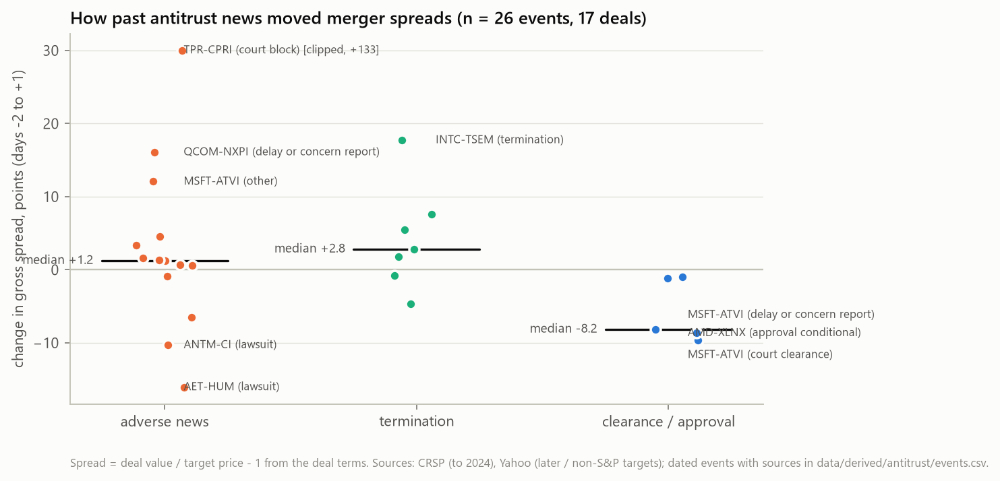

# Antitrust risk: how regulatory news moves LITE, MRVL and the spread, and how to trade it

**As of the 2026-11-24 close** (LITE $487.12, MRVL $131.57, gross spread 21.5%). Model: `mergerarb/analytics/antitrust.py`;
run `python scripts/run_antitrust.py` (numbers in [`antitrust_numbers.json`](antitrust_numbers.json)) and
`python scripts/antitrust_event_study.py` (needs local CRSP). Research only, not investment advice.

## Bottom line

1. **Regulatory risk is mostly China, and it is large.**
   - The combined company would be the dominant merchant DSP supplier. A Chinese prospectus puts Broadcom and Marvell at
     about 90% of optical-module DSPs, with Marvell alone at 60-70% of 50-100G/lane PAM4.
   - It would also be a laser and module rival of its own Chinese DSP customers (InnoLight, Hisense, Accelink and others).
   - China's SAMR conditioned the comparable US chip deals (Nvidia-Mellanox, AMD-Xilinx, Broadcom-VMware, Synopsys-Ansys)
     with no-bundling, supply and interoperability remedies after 13-18 months.
   - It let four others lapse (Qualcomm-NXP, Applied-Kokusai, Intel-Tower, DuPont-Rogers) when tensions were high.
   - The base rate is about two thirds approved. The November-2026 climate leans negative: new US AI-chip controls on
     16 Nov, new tariff plans, and a truce extended only to 10 Jan 2027.
2. **Gate by gate, completion is about 48%, in line with the market's ~50%.**
   - US 93%, stockholder votes 81%, EU 94%, China 69%, other 97%.
   - The first report's 63% assumed 80% for all regulators together, which is too generous.
   - Because the votes come first, 61% of breaks would be regulatory terminations that pay LITE the $3.2bn fee.
3. **Antitrust worries hit the trade mostly through MRVL, not LITE.**
   - Prices are a probability-weighted mix of "deal" and "no deal" values, and MRVL fell about 21% on the deal.
   - Bad regulatory news therefore lifts MRVL more than it sinks LITE. With three quarters of MRVL's discount reversing
     on a break (the base case), LITE even *rises* slightly on bad news.
   - The hedged position loses the same dollars either way: **about $21 per LITE share for every 10-point drop in the
     market's completion odds** (the gap G = spread / (1 - q) = $210 at q = 50%).
4. **The odds are fairly priced. The edge, if any, is in LITE's break value.** *(Revised after the 2026-11-25 triple check.)*
   - At our odds the market prices LITE at $494-534 on a break, below its factor-model value of $613 (±15%). If the factor
     model is right, the trade earns about 5% a year above Treasuries even with no view on the regulators (signal WATCH).
     If the market is right, it is roughly fair.
   - In the news-flow simulation, holding from today earned **~9% a year** on capital before financing if LITE trades at
     its factor value after a break (~5% after financing), and ~0 if the market's break value is right.
   - Waiting for a 27% spread did about as well (9.3% a year) and helped most if you are also more optimistic on the odds.
     It hurt if you are more pessimistic.

## 1. What regulators will look at

| Issue | Evidence | Who cares |
|---|---|---|
| Vertical foreclosure: DSPs | Accelink 2026 prospectus (via your optical-intel DB): Broadcom + Inphi/Marvell ≈ 90% of module DSPs; Marvell 60-70% of 50-100G/lane PAM4. Marvell's documented DSP customers: InnoLight, Hisense, Accelink, Linktel, Source Photonics, Huagong, Lumentum, Coherent (demo). | SAMR (its domestic module makers depend on Marvell DSPs); FTC/DOJ (Coherent, AAOI); EU |
| Vertical foreclosure: lasers | Lumentum is a leading merchant EML/CW laser supplier in a tight market (its gross margin doubled in seven quarters). It also sells transceivers and optical circuit switches. | SAMR, US agencies, hyperscalers |
| Competitor perception | Accelink already lists Marvell (with Coherent and Cisco/Acacia) as a main foreign module competitor. | SAMR |
| Horizontal overlap | Coherent DCI pluggables and optical engines exist on both sides, but they are small next to the vertical issues (not quantified here). | US / EU |
| Remedy appetite | Marvell said it intends to keep its existing component supply model (Disruption Banking, read in full). This is an early signal it will offer behavioural commitments. The merger agreement makes Marvell accept remedies unless they are *material to the combined company* (s6.3(d)). | all |
| Strategic customer | NVIDIA owns LITE preferred stock and has a multi-billion purchase commitment with Lumentum (LITE 8-K, 2026-03-02). Its stance is unknown. | US agencies |

**Timeline anchors from the merger agreement:**
- The first outside date is 2027-11-01. It extends automatically to 2028-02-01, then 2028-05-01, then **2028-08-01** while
  only regulatory conditions remain open.
- Marvell pays **$3.2bn** (~$26 per LITE share after tax) on a regulatory failure.
- One Substack piece gives a "Nov-2028" outside date. That is wrong.

## 2. China's track record with comparable deals (research agent, sourced in `data/derived/antitrust/samr_precedents.csv`)

| Outcome | Deals | Review |
|---|---|---|
| Conditional (behavioural, sometimes divestitures) | Nvidia-Mellanox, AMD-Xilinx, Broadcom-VMware, Synopsys-Ansys | 13-18 months; no bundling, FRAND/continued supply to Chinese customers, interoperability; 6-10 years |
| Unconditional (no remedies found) | Marvell-Cavium, Marvell-Inphi, II-VI-Coherent, Lumentum-NeoPhotonics | 5-15 months; small or no overlap |
| Lapsed (no decision by the outside date) | Qualcomm-NXP, Applied-Kokusai, Intel-Tower, DuPont-Rogers | 12-21 months, in tension periods; never a formal prohibition |

The base rate is 8 of 12 decided cases approved (≈ 67%). Marvell-Lumentum's vertical, China-customer-heavy profile looks
like the *conditional* group, not the quick unconditional one. Expect a long review and behavioural remedies. The tail
risk is a timeout if relations sour. SAMR cleared 420 of 440 filings unconditionally in the first nine months of 2026
(state media; search snippet). Slowing deals down, not prohibiting them, is its lever.

## 3. The mechanism: how a regulatory headline turns into stock moves

Each price is a mix of its completion and break values, weighted by the market's completion probability q:

    M = q*M_C + (1-q)*M_B        L = q*4.5*M_C + (1-q)*S

With G = 4.5*M_B - S (how much more the 4.5 MRVL shares would be worth than LITE after a break):

    spread$ = (1-q)*G      completion P&L = (1-q)*G      break P&L = -q*G      dP&L/dq = G

Today's $104.94 spread pins G down once q is chosen: **$161 at q = 35%, $210 at 50%, $300 at 65%**. The split between
the legs depends on how much of MRVL's ~21% deal discount would reverse on a break.

| A 10-point drop in completion odds (q 50% → 40%) | LITE | MRVL | Gross spread | Hedged P&L per LITE share |
|---|---|---|---|---|
| No MRVL reversal | -4.3% | 0.0% | +5.7 pts | -$21 |
| Half reverses | -1.0% | +2.7% | +4.6 pts | -$21 |
| Three quarters reverse (base since 2026-11-25) | +0.6% | +4.0% | +4.1 pts | -$21 |
| Full reversal | +2.2% | +5.4% | +3.6 pts | -$21 |

*(From `shock_table`; same P&L by construction. Only the split moves.)*

## 4. What each headline does today

Bayesian updates from the base event tree, applied at the market's ~50% odds, with three quarters of MRVL's discount
reversing on a break. Columns:
- "From today" is the change once the headline is known.
- "On the day" starts from the news that must come first. A court ruling follows a lawsuit, so a block costs only $45
  on the day; the other $60 was lost when the suit was filed.

| Headline | Odds after | LITE | MRVL | Spread | P&L / LITE sh, from today | On the day |
|---|---|---|---|---|---|---|
| HSR second request (75% likely, mostly priced) | 49% | +0.1% | +0.5% | +0.5 pt | -$3 | -$3 |
| EU opens phase 2 (40%) | 45% | +0.3% | +1.9% | +2.0 pts | -$10 | -$10 |
| SAMR acceptance delayed / pull-and-refile (5%) | 36% | +0.8% | +5.6% | +5.7 pts | -$29 | -$29 |
| US agency sues (11%) | 21% | +1.7% | +11.6% | +11.7 pts | -$60 | -$57 |
| Court blocks the merger (after a suit) | 0% | +3.1% | +20.2% | +20.3 pts | -$105 | -$45 |
| Court rules for the merger (after a suit) | 54% | -0.2% | -1.5% | -1.5 pts | +$8 | **+$68** |
| A stockholder vote fails | 0% | +3.1% | +20.2% | +20.3 pts | -$105 | -$105 |
| Both votes pass (81%) | 62% | -0.7% | -4.7% | -4.9 pts | +$25 | +$25 |
| SAMR conditional approval | 72% | -1.4% | -9.1% | -9.5 pts | +$47 | +$46 |

The P&L column does not depend on the reversal assumption; only the split between the legs does. With half the discount
reversing, LITE falls 2.9% on a US suit and MRVL rises 7.7%. With all of it reversing, LITE rises 6%.

Inside SAMR's decision window, a fair price also decays week by week while no decision arrives; the news simulation
models that. A SAMR timeout is therefore mostly priced before the formal termination.

## 5. What past antitrust news actually did

26 dated events in 17 deals (`data/derived/antitrust/event_study.csv`).
- **Medians:** adverse news +1.2 spread points, terminations +2.8, approvals and clearances -8.2.
- **Surprises are violent:** Capri -49% on the court block (spread +133 pts), NXP -13% on reports China would not approve
  (+16 pts), Activision -11% on the UK block (+12 pts), Tower -10% at termination (+18 pts).
- **Acquirers rallied when deals looked shaky:** Tapestry +15.5%, Qualcomm +6.5%, Kroger +3.7% / +9.4%. Microsoft rose
  8% around the UK block, but that is contaminated by its earnings. This is the same MRVL behaviour the model predicts.
- **Expected steps barely moved prices.** Phase-2 openings and anticipated lawsuits were mostly priced already, and
  approvals tightened spreads sharply (AMD-Xilinx -8.7 pts on China's approval).
- *Caveats:* event dates come from news searches (confidence column in the CSV). The Aetna/Humana and Anthem/Cigna
  lawsuit days show the targets *rising*, which points to other news or an earlier leak. Treat those two as unreliable.
  For stock deals the spread change is the clean measure; raw target returns are swamped by the acquirer's moves.

## 6. Completion probability, gate by gate

| Gate | Pessimist | **Base** | Optimist | Basis |
|---|---|---|---|---|
| US (HSR → second request → consent or suit → court) | 0.89 | **0.93** | 0.93 | second request 75%; suit 11-19%; parties win ~40% in court |
| Both stockholder votes | 0.81 | **0.81** | 0.90 | MRVL votes cast (low bar) but dilution anger; LITE needs a majority of *outstanding*, the offer is below the pre-talks price, CEO admits holders are "not happy" |
| EU | 0.94 | **0.94** | 0.94 | phase 2 40%, clearance after phase 2 85% |
| China SAMR | 0.55 | **0.69** | 0.79 | 2016-25 base rate ≈ 67-69%; vertical + China-customer profile; Nov-2026 escalation |
| No other termination | 0.97 | **0.97** | 0.97 | |
| **P(complete)** | **0.36** | **0.48** | **0.60** | |

## 7. Trading playbook

**Today: potentially attractive, small size only (signal WATCH).** *(Revised 2026-11-25 after the triple check; the
earlier "no trade" left out the regulatory fee and used a pessimistic break value as its base.)*
- At a 21.5% spread (23.6% at the Nov 25 close) and 48% completion, the base case earns ~5.3% a year above Treasuries on
  Reg T capital. It needs a 21% spread to clear the 5% hurdle.
- The base case assumes LITE trades at its factor-model value ($613) on a break and MRVL recovers 3/4 of its discount.
- With the first version's blended break value ($512) it is -3.2% a year. The stress case needs 77% completion odds.

**Where an edge could come from** (`news_mc`: outcomes drawn from *your* tree, prices from the market's; your break
value applied when a break happens; 20,000 paths; one lot = 2 LITE / 9 MRVL):

| World | Enter today, hold | Exit on US suit / SAMR slip | Wait for ≥ 27% spread | After US clears | After both votes |
|---|---|---|---|---|---|
| No edge (your odds and break value = market's) | -0.2%/yr | -0.5% | 0.0% | +0.2% | +0.2% |
| Your break value (factor model), market's odds | **+9.1%** | +7.8% | +9.3% | +11.5% | +12.1% |
| ... and more optimistic odds (60%) | +10.4% | +9.0% | **+12.8%** | +13.1% | +13.5% |
| ... and more pessimistic odds (36%) | +7.8% | +5.9% | +6.1% | +9.1% | +9.5% |
| Market's break value, more optimistic odds | +3.6% | +3.5% | +6.0% | +4.5% | +3.6% |

How to read the table:
- Figures are P&L per unit of capital-time, *before* financing the long leg (subtract ~4%).
- The milestone strategies earn more per year of capital because they hold for a shorter time and trade less often.
- The 27% rung was hit in 86% of paths, at an average entry spread of 31%.
- The no-edge row is now about zero. Before the fix, the fee was counted twice and this row showed a profit.

The edge comes mainly from the break-value view: with the market's break value, even a 60% completion view earns only
3.6-6% before financing. A stop on a US lawsuit trims the tail but crystallises losses after the drop, so it lowered the
average in every world.

**Rules for this account (USD 10k):**
1. **Entry:**
   - The trigger ladder alerts at **23%** gross executable spread for one lot, and **27%** for a second lot only with
     ≥ $20k equity (`execution/trigger.py`). The Nov 25 close was 23.6%, but triggers ignore closing prints.
   - Before adding size, wait for the S-4 (expected early December). Its standalone projections and fairness ranges
     are the best available check on the $613 break value.
   - Triggers fire only on **live** two-sided quotes, using the *executable* spread (MRVL bid, LITE ask).
   - Every hit still needs pre-flight checks and your typed approval.
2. **Size:**
   - At most **one 2/9 lot per $10k** (Monte Carlo 95% expected shortfall ≈ $2,000 per lot).
   - Options cannot hedge this: one MRVL option contract covers 100 shares, which is 22 LITE shares (~$10.7k long).
3. **Hold or cut:**
   - Hold through expected steps (second request, EU phase 2): they are mostly priced.
   - Re-assess on a US lawsuit (historically most litigated deals died: Aetna-Humana, Anthem-Cigna, Halliburton-Baker
     Hughes, Tapestry-Capri, Kroger-Albertsons; Microsoft-Activision survived, HPE-Juniper settled). Cut at least half
     unless you rate the court case well above 40%.
   - Cut on a SAMR pull-and-refile *combined with* trade-war escalation.
4. **Hard stops:** borrow fee > 3% or recall notices, excess liquidity < 50% of equity, or any change to the exchange
   ratio.

**Dated catalysts to watch:**
- 10 Jan 2027: US-China truce expiry.
- ~Jan 2027: HSR second request (expected).
- Q1 2027: S-4 filing, which names the required approvals and the merger background.
- ~Mar 2027: SAMR filing accepted.
- ~May 2027: EU phase-1 outcome.
- ~Mid-2027: both votes.
- ~Aug 2027: US decision.
- 1 Nov 2027: first outside date.
- Oct 2027 to Jul 2028: SAMR decision.
- 1 Aug 2028: final outside date.
- Also: any US export control reaching optical components (the clearest negative SAMR signal), and MRVL earnings on
  1 Dec 2026 (re-run scheduled for 2 Dec).

## 8. Being able to trade it: the checklist
1. Install TWS or IB Gateway, log in to the **paper** account, enable the API (127.0.0.1, port 7497/4002), and subscribe
   to US real-time quotes (NASDAQ). Triggers ignore delayed data.
2. `python -m mergerarb.execution.readiness` should print READY. It checks the account type, funds, data type,
   shortability, IBKR's what-if margin for one lot, the session and the executable spread. It places no orders.
3. `python -m mergerarb.execution.service`, then `MERGERARB_ENABLE_EXECUTION=1 streamlit run app/streamlit_app.py`.
   Arm the ladder, wait for a hit, run pre-flight, type the confirmation, and send. The short leg goes first; the target
   is bought only against filled short shares.
4. Paper-trade one full cycle (entry, partial fills, cancel/recover) before considering live mode
   (`MERGERARB_ALLOW_LIVE=1`).

## 9. Provenance and limits
- **Read in full:** the merger agreement, 8-Ks and press release; your optical-intel records (Accelink prospectus quotes
  in Chinese, DSP customer map); Disruption Banking.
- **Search snippets only:** SAMR precedent coverage, US-China climate (China Briefing, Fortune, CNN, SCMP, The National,
  ECNS), commentary pieces.
- **Every probability is judgment.** The tree's branch probabilities, the ladder rungs (23% / 27%), the break value and
  the reversal fraction are parameters; change them in the dashboard's Antitrust tab.
- **Corrected 2026-11-25:** the news simulation no longer counts the regulatory fee twice; Marvell's cost of the fee is
  modelled; the market's odds decay inside SAMR's window while no decision arrives; the headline table separates "from
  today" from "on the day".
- **Event study:** small sample (26 events) with uncertain dates for some of them; it is used for direction and
  magnitude, not for calibrating probabilities.
