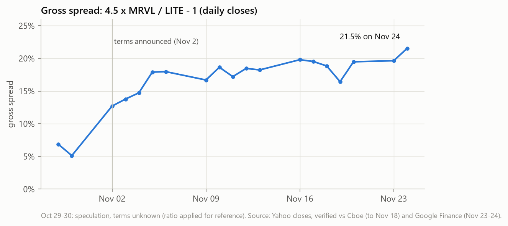
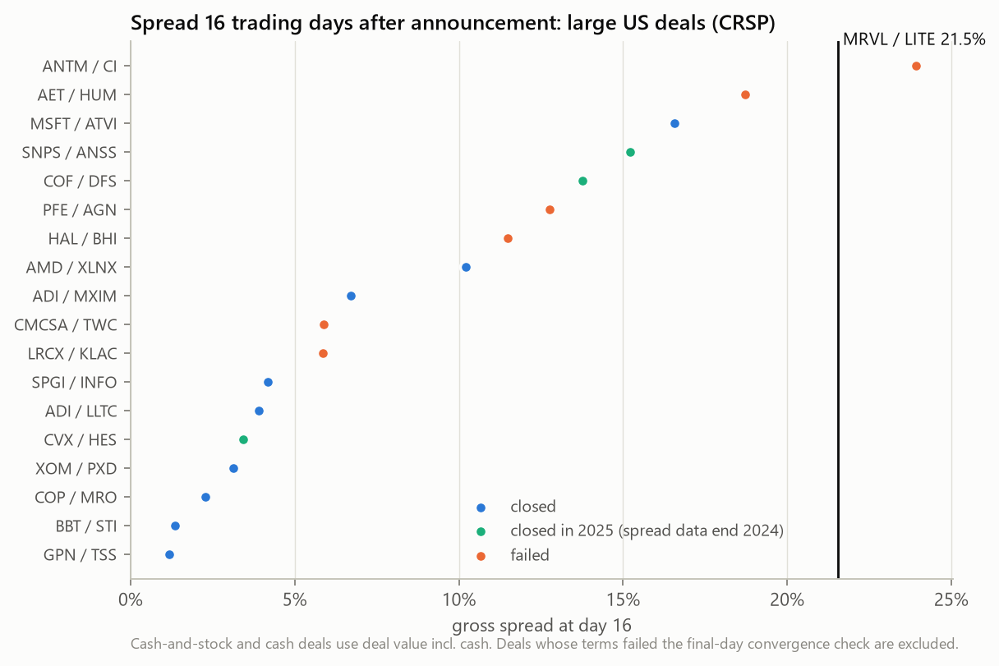
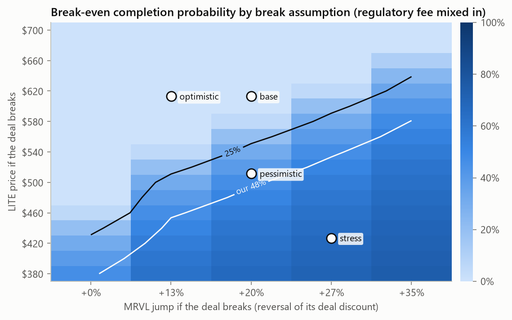
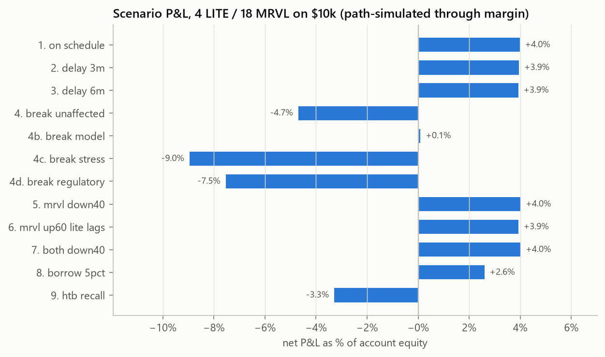
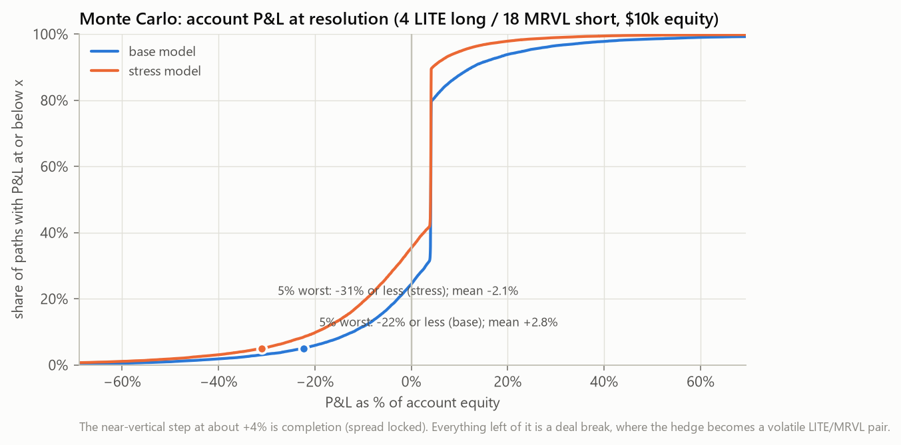

# Marvell / Lumentum merger arbitrage: research report

**As of the 2026-11-24 close.** LITE $487.12, MRVL $131.57 (closing prints; not live). Every number below comes from
`python scripts/build_report_assets.py` (deterministic seeds); the machine-written values are in
[`report_numbers.json`](report_numbers.json). Research only, not investment advice.

## Verdict: potentially attractive, small size only (signal WATCH)

*Revised 2026-11-25 after a triple check (below).* The first version said WATCH at 63% completion odds. The antitrust
revision (same day, earlier) lowered completion to **48%** and turned the call into NO TRADE. The triple check then found
that the NO TRADE rested on a bug and a biased assumption:
- the regulatory reverse fee was left out of the signal;
- LITE's break value used the evidence-based estimate as its best case.

Corrected, the trade carries a modest positive expected return. The edge rests on one estimate that cannot be verified
(what LITE is worth on its own), and it lies inside that estimate's error band.

The 21.5% gross spread is real: no data error, wrong ratio or stale quote. It is wide because:
- the market gives the deal roughly even odds over a long, politically exposed timetable;
- China's SAMR is the main risk;
- MRVL's holders dislike the deal.

| Case | Outcome |
|---|---|
| **If it closes** | A hedged position earns **$101 per LITE share** before trading costs ($99 after), about 15% a year. |
| **If it breaks** | The hedge becomes a LITE/MRVL pair trade. Its outcome depends mostly on where LITE trades on its own and how much of MRVL's 21% deal discount reverses. |

| At 48% completion odds, after the cost of financing the long leg | Value |
|---|---|
| **Base case**: LITE at its factor-model value ($613, ±15%); 3/4 of MRVL's discount reverses; the $3.2bn fee on regulatory breaks | expected P&L **+$33 per LITE share** (+$59 before financing). That is **+5.3% a year** on Reg T capital, just over the 5% hurdle. A failed vote is roughly break-even (−$0.2/share); a regulatory break **+$39** (the fee). |
| **Pessimistic case**: the first version's blended break value ($512), same reversal | **−3.2% a year** (NO TRADE) |
| **Stress case**: LITE trades like AAOI ($427), MRVL fully rebounds | −$85 per share; break-even completion probability **77%** |
| **Spread needed for 5% a year** | **21.0%** in the base case (21.5% on Nov 24; **23.6% at the Nov 25 close**); 34.6% in the pessimistic case |
| **What the market implies** | at our odds, LITE worth **$494** on a break (3/4 reversal) or **$534** (full reversal), against $613 from the factor model. That puts it in the worst 16-35% of how single names strayed from the same model in this crash. |
| **Position cap for a $10k account** | **1 lot = 2 LITE long / 9 MRVL short** (95% expected shortfall ≈ 20% of equity per lot); 2 lots at most (loss budget) |

**Classification** (from the brief's four options): **Potentially attractive.** A one-lot-per-$10k position is
defensible if you accept the factor-model break value. It is not a high-conviction arbitrage:
- the edge is the gap between $613 and the $494-534 the market implies, about 1 to 1½ standard deviations of that
  estimate's error;
- the stress case still loses.

**Automated signal** (`mergerarb.analytics.signal`): **WATCH**. The base case clears the 5% hurdle; the only soft flag is
the stress case. The alert ladder now watches **23%** (one lot) and **27%** (a second lot from $20k of equity; the
pessimistic case breaks even there). The Nov 25 close was 23.6%.

## Triple check (2026-11-25): what was re-verified and what was wrong

Three passes, run independently:

1. **Facts.** The termination and fee clauses of the merger agreement were re-read: s8.1, s8.2(b)-(d), s6.3(d), the
   outside-date chain, and the share counts in s4.2(c)(i). All terms in `deals/mrvl_lite.yaml` match. Marvell's preferred
   converts at 10.889 common, which gives 899.8m fully diluted shares for the fee's cost per MRVL share. No new 8-K, S-4
   or regulatory news since Nov 24 (EDGAR, news search); the CEO said the S-4 is due "in a couple of weeks" (Lumentum 425,
   2026-11-24). Prices re-checked; the Nov 25 close is LITE $476.58, MRVL $130.93, spread 23.6%.
2. **Arithmetic.** The key numbers were recomputed from scratch without the package. The old base expected P&L
   ($18.44 per share) was reproduced to the cent, so the arithmetic was right; the problems were in what went into it.
3. **Code and assumptions.** Two independent reviews (analytics and execution) plus my own.

| Finding | Type | Effect |
|---|---|---|
| The signal, EV grid and implied grids left out the $3.2bn regulatory fee, although 61% of modelled breaks are regulatory | bug | expected P&L understated by ~$8 per share |
| The fee's cost to Marvell (its stock falls by ~$2.81 after tax on a regulatory termination, a gain for the short leg) was not modelled anywhere | omission | another ~$8 per share |
| LITE's base break value was the geometric midpoint of the factor model ($613) and the worst optical peer ($427), so the evidence-based estimate became the *best* case | biased assumption | the main driver: $512 sits at the 10th percentile of how 49 names strayed from their factor models in this crash |
| MRVL's deal discount was assumed to reverse only by half on a break | optimistic assumption | partly offsets: the discount appeared on the leak and announcement days (-22.5% abnormal) and stayed flat, and Tapestry reversed all of its drop when Capri was blocked. Base is now 3/4 (range 1/2 to all). |
| The Treasury hurdle was charged on Reg T capital over the full time to close | small error | IBKR does not let short proceeds fund the long leg for interest ("adjusted cash" excludes short collateral) and pays 0% on them below $100k, so the right charge is the Treasury rate on the long leg while the position is open. Breaks resolve earlier (0.98 years on average). |
| Trading costs ($2.08 per share round trip) were missing from the signal | omission | small |
| The news-flow simulation counted the fee twice, and its market odds were not a fair price inside SAMR's decision window (they sat at 70% until a decision instead of decaying) | bugs | the "no edge" world showed a profit; fixed (now about -$1 per share) |
| The headline table measured second-stage news (court rulings) from today's odds | labelling | it now shows "from today" and "on the day" |
| Scenario 4d used the pre-tax fee; scenarios 5 and 7 are identical | bug / note | fixed; 5 = 7 by construction with a fixed-ratio hedge |
| The hedge comparison let MRVL keep today's price on completing paths, so smaller hedges looked better than they are | bug | fixed: on completion MRVL now ends at its deal-state value, and an unhedged LITE position loses (-$22 per share) |
| The IBKR execution tool could send unapproved orders, e.g. "Cancel all" re-placing a LITE buy, or dead LITE orders being re-sent indefinitely | serious bugs | fixed and re-tested; see [EXECUTION.md](EXECUTION.md) |

**What was checked and is right:** deal terms; prices and the spread; carry (5 dividends, borrow); completion and break
algebra; the gate tree arithmetic (48%); margin formulas and the sizing table; the Monte Carlo mechanics.

**Evidence on LITE's break value** (`scripts/crash_crosssection.py`):
- Nine factor specifications (SMH, optical peers, both; 126/252/504 days) give **$600-629**.
- Across 49 AI and semiconductor names, the crash residual (actual minus factor-predicted, Oct 28 to Nov 24) has a
  mean of 0 and a standard deviation of **14.7%**, matching the model's own band (14.9%).
- Past winners did *not* fall more: residual on 12-month momentum t = -0.06; on 6-month t = -1.66, which predicts
  ~0 for LITE.
- So the factor model is the central estimate and ±15% its error. The base Monte Carlo now draws LITE's break value
  that way, instead of uniformly between the stress and factor values.

---

## 1. The transaction (primary sources)

All terms come from the Agreement and Plan of Merger dated 2026-11-01 (Exhibit 2.1 to Marvell's 8-K, read in full),
Marvell's 8-K Item 1.01 and the joint press release. Links are in [Sources](#sources).

| Term | Detail |
|---|---|
| Consideration | **4.50 MRVL shares per LITE share** (s3.1(a)(i)); no cash; cash in lieu of fractions (s3.1(e)) |
| Collar / adjustment | **None.** Fixed ratio; s3.3 adjusts it only for splits, reverse splits and stock dividends. Both parties are barred from splits pending closing (s5.1). |
| LITE preferred (NVIDIA) | 2,876,415 Series A preferred convert as-converted x 4.5 into MRVL common, or elect MRVL Series B preferred (s3.1(a)(ii)) |
| Unaffected prices (Oct 28) | LITE $913.95, MRVL $251.65. 4.5 x 251.65 = $1,132.4, a 23.9% premium, which reproduces the press release. |
| Expected closing | "first half of calendar year 2028" (press release). Model base: 2028-03-31. |
| Outside date | 2027-11-01, extended automatically to 2028-02-01, then 2028-05-01, then **2028-08-01** while only regulatory conditions remain open (s8.1(b)(i)) |
| Votes | LITE: majority of **outstanding** voting power (s4.1(s)). MRVL: share issuance by a majority of votes present; charter amendment raising authorised shares (1.25bn) by a majority of **votes cast** (s4.2(r)). |
| Regulatory | HSR plus the approvals listed in s7.1(c) of the confidential Parent Disclosure Letter, so **the jurisdictions are not public** until the S-4. Efforts: reasonable best efforts. Marvell must accept remedies unless they are material to the combined company ("Burdensome Condition", s6.3(d)). |
| Termination fees | Marvell to LITE **$5.8bn** (MRVL board change of recommendation or Parent superior proposal); LITE to Marvell **$2.9bn**; regulatory reverse fee Marvell to LITE **$3.2bn** (~$33 per LITE share fully diluted) (s8.2). No fee is described for a plain failed vote. |
| Dividends | MRVL may keep paying its regular $0.06 quarterly dividend (s5.1(b)(i)); LITE may not pay any (s5.1(a)(i)) |
| Shares | LITE 93,459,271 common (8-K, 2026-11-23); MRVL 877,987,882 common (s4.2(b)) |

**What a LITE holder receives:** 4.5 MRVL shares per share. **The hedge:** short exactly 4.5 MRVL per LITE long. IBKR
does not allow fractional short sales, so the smallest exact lot is **2 LITE / 9 MRVL** ($974 long / $1,184 short at
today's closes). At completion the LITE shares convert into MRVL shares that offset the short in the same account, so no
closing trade is needed.

## 2. The spread, and why it is this wide

- **Today:** implied value 4.5 x $131.57 = **$592.07** vs LITE $487.12, so the spread is **$104.94 (21.5%)**. To a
  2028-03-31 close (1.35 years) that is **15.5% a year compounded**.
- **Since the terms were announced:** the spread opened at 12.7% (Nov 2) and drifted wider. Mean 17.7%, standard
  deviation 2.3 points, daily changes with a 1.6-point standard deviation. **Today's 21.5% is the widest close since
  announcement** (100th percentile, z = 1.65, n = 17).

### Is it a data error? No.
- **Ratio:** 4.50, from the merger agreement itself, cross-checked against the press release's $1,132 and 23.9%.
- **Prices:** Yahoo daily closes match an independent Cboe download exactly for Oct 20 to Nov 18 (22 sessions per stock,
  zero difference). Google Finance confirms the Nov 23 and Nov 24 closes for both.
- **Stale quotes:** Yahoo's after-hours bid/ask pairs are unusable (LITE bid 559.21 > ask 542.79; QQQ bid 717 vs last
  638). The tool flags and ignores them; only closing prints are used.
- **Splits / corporate actions:** none in the data, and the agreement prohibits them before closing.
- **Stale market data generally:** the whole AI-semiconductor complex really did crash this month. LITE is down 46.7%
  and MRVL 47.7% since Oct 28 (SMH -24.8%, AAOI -53%, COHR -18%). The press reports the same moves (e.g. NVIDIA +31% on
  Nov 23 after its CEO was reinstated; snippets only).

### Is it unusually wide? Yes: wider than every comparable deal that closed.

The comparison uses CRSP daily data for 21 large US deals. 16 trading days after announcement (where MRVL/LITE is
today), the nine validated completed deals ranged from 1.2% to 16.6% (**median 3.9%**). Six deals that later failed had
a **median of 12.1%**. Only Anthem/Cigna (23.9%, later blocked in court) was wider than MRVL/LITE is now. Wide spreads
have still closed: Microsoft/Activision was at 16.6% on day 16, and AMD/Xilinx reached 41.5% during China's review in
2021 before closing. Terms were validated by requiring the final-day spread of each completed deal to be within ±1.5%.
DuPont/Dow and Avago/Broadcom failed that test and are excluded. Raw CRSP data are licensed and are not in this repository.

### Why the market charges this much

1. **Time and China.** Closing is guided to 1H-2028, and the outside-date chain runs to 2028-08-01. Commentators name
   China's SAMR as the main antitrust and timing question (Breakingviews, Bloomberg Intelligence; search snippets).
   SAMR has let US chip deals lapse before: Intel ended its $5.4bn Tower acquisition in August 2023 after China failed
   to approve it in time (Bloomberg, Fortune, SCMP). DuPont paid a $162.5m fee when its Rogers deal failed SAMR review
   (search snippet). Qualcomm/NXP (2018) ended the same way (public record; not re-verified here). SAMR has also cleared
   Marvell's own Cavium and Inphi deals, which management cites as a reason its timetable is conservative (snippet).
2. **Both shareholder votes.** MRVL fell about 20% more than its sector beta implied around the announcement, and
   holders cite dilution. LITE's vote needs a majority of *outstanding* shares. The offer ($592) is now worth far less
   than LITE's pre-talks price ($914) and below our factor-model standalone value. LITE's CEO says shareholders are
   "not happy" (CNBC/Semafor, 2026-11-19; snippets).
3. **A crash regime that raises the cost of arbitrage capital.** Realised volatility since announcement is 164% (LITE)
   and 145% (MRVL) annualised. MRVL's option-implied volatility to March 2028 is 71% (front month 123%). FINRA short
   interest in MRVL rose only 6.6m shares between Oct 30 and Nov 13, about 1.5m LITE-equivalent arb positions (~1.6% of
   LITE). Arbitrage desks are not crowding in.
4. **Size.** LITE's equity is about $46bn at today's price. Large deals routinely outstrip dedicated arbitrage capital.
5. **Not borrow.** MRVL costs 0.32% a year to borrow with 10m shares available at IBKR (iBorrowDesk, 2026-11-24 16:44 ET).
   The three-month range is about 0.25-0.45% (read off the chart). Put-call parity across 17 expiries implies a borrow
   premium of about zero.

**What the market may know that we don't:** the confidential list of required approvals (Parent Disclosure Letter
s7.1(c)); arbitrage desks' counsel views and regulators' soundings; how large holders intend to vote and what proxy
advisers will say; customer reactions (NVIDIA owns LITE preferred); and the internal capital limits of the funds that
would normally close a spread like this. Bloomberg reported arbitrage specialists putting completion near **50%**
(2026-11-09; snippet only).

## 3. Quantitative model (`mergerarb/`)

### 3.1 Where would the stocks trade if the deal broke?
The textbook answer, "back to the unaffected price", is wrong after a 47% sector crash. Both unaffected prices are
snapshots of a market that no longer exists. Both stocks are therefore projected forward from Oct 28 with factor models
estimated on the 252 sessions before any deal news (`analytics/standalone.py`):

| LITE standalone estimate (as of Nov 24) | Price | ±1 residual sd |
|---|---|---|
| Two-factor (SMH + equal-weight optical peers), R² 0.70: the **base** case (central estimate) | **$613** | $528-712 |
| Beta to SMH only | $599 | $483-744 |
| Peer ratio (COHR, AAOI, FN, CIEN) | $625 | $427-749 |
| Geometric midpoint of $613 and $427: the first version's base, now the **pessimistic** case | $512 | - |
| Worst optical peer (AAOI-like, -53%): the **stress** case | **$427** | - |

MRVL's no-deal counterfactual (beta 1.44 to SMH) is **$167**, so **21.2% of its current price is a deal discount**. It
appeared on the leak and announcement days and has not moved since. If the deal breaks:
- **base:** three quarters of the discount reverses (+20.2%), drawn between half and all of it in the Monte Carlo;
- **optimistic:** half reverses (+13.5%);
- **stress:** all of it reverses (+27.0%).

On a regulatory termination Marvell also pays the $3.2bn fee: about $2.81 per MRVL share after tax, which the short leg
gains, and $26.24 per LITE share, which the long leg gains.

### 3.2 Per-share payoffs of the exact hedge
**Completion: C = $104.94 spread - $1.35 dividends owed on the short (5 x $0.27) - $2.56 borrow = $101.04**
($98.96 after $2.08 of commissions, half-spread and slippage). This is locked regardless of where MRVL trades.

Break P&L per LITE share, before trading costs. "Average" weights the two by 61% regulatory / 39% vote or other, the
model's mix:

| Break case | LITE | MRVL jump | Failed vote / other | Regulatory (fee) | Average | Break-even p (gross / after financing) |
|---|---|---|---|---|---|---|
| Optimistic: factor model, half reversal | $613 | +13.5% | +$43.9 | +$82.8 | +$67.6 | 0% / 0% |
| **Base: factor model, 3/4 reversal** | $613 | +20.2% | **+$3.9** | **+$42.8** | **+$27.6** | **0% / 0%** |
| Factor model, full reversal | $613 | +27.0% | -$36.0 | +$2.9 | -$12.3 | 11% / 36% |
| Pessimistic: blend, 3/4 reversal | $512 | +20.2% | -$97.5 | -$58.6 | -$73.8 | 42% / 59% |
| First version's base: blend, half reversal | $512 | +13.5% | -$57.6 | -$18.7 | -$33.9 | 25% / 47% |
| Stress: AAOI-like, full reversal | $427 | +27.0% | -$222.1 | -$183.2 | -$198.4 | 66% / 77% |
| Literal brief: both back to Oct-28 prices | $914 | +91% | -$115.6 | -$76.7 | -$91.9 | 48% / 63% |

The literal "LITE returns to its unaffected price" case is shown as asked, but it means LITE nearly doubles. The arb
still loses, because MRVL nearly doubles too.

**Market-implied view.** At our 48% odds, today's prices imply a LITE break price (before the fee) of:
- **$454** if half of MRVL's discount reverses;
- **$494** if three quarters do;
- **$534** if all of it does.

At the arb desks' ~50% the three are $444, $484 and $524. All sit below the factor model's $613. Either:
- the market expects LITE to fall further than its betas imply (at the 16th-35th percentile of the crash cross-section);
- or it doubts the deal more than we do;
- or arbitrage capital is too scarce in this crash to close the gap. MRVL short interest barely rose (section 2).

### 3.3 Completion probability: a labelled judgment, not a fact
| Condition | Low | Base | High | Rationale (abridged; full text in `analytics/probability.py`) |
|---|---|---|---|---|
| MRVL stockholders approve | 80% | 90% | 95% | low votes-cast bar; unanimous board; but a hostile reaction and dilution complaints |
| LITE stockholders approve | 80% | 90% | 96% | majority of outstanding; offer below pre-talks price; unhappy holders |
| Regulatory approvals before 2028-08-01 | 46% | 60.5% | 74% | gate by gate: US 0.93 × EU 0.94 × China 0.69 (SAMR base rate for comparable US chip deals); see [ANTITRUST_AND_TRADING.md](ANTITRUST_AND_TRADING.md) |
| No other termination | 93% | 97% | 99% | standard MAE carve-outs, reciprocal no-shops, large fees |
| **P(complete)** | **27%** | **48%** (47.5%) | **67%** | product; assumes independence (the first version had 80% for regulation and 63% overall) |

Because the votes come first, **61% of breaks are regulatory terminations** that pay the $3.2bn fee; the other 39% are
failed votes or other terminations, which pay nothing (s8.2(c)-(d)).

### 3.4 Expected return

**How the return is measured.** Expected P&L, net of the opportunity cost of the cash that pays for the long leg, per
year of Reg T capital actually used. Breaks resolve after 0.98 years on average, completion after 1.35. IBKR treats
short-sale proceeds as collateral that earns nothing below $100k, so they do not offset that cost.

**Base case at 48%:**
- expected P&L **+$59 per LITE share**, or **+$33 after financing**;
- that is **+5.3% a year** on Reg T capital ($540 per share), just over the 5% hurdle;
- the break-even completion probability is 0%: on average a break roughly pays for itself, because a failed vote is
  about flat and a regulatory break earns the fee.

**Other cases:**
- **Pessimistic break value:** -3.2% a year at 48%; it needs ~60% odds to break even.
- **Stress case:** negative until ~80%.
- **Under the first version's own assumptions** (blend, half reversal), the fee and financing corrections alone move
  -2.1% to **+0.2%** a year: roughly fair.

### 3.5 Scenarios (`analytics/scenarios.py`)
Each scenario runs day by day through an IBKR-style margin account. Borrow accrues daily, dividends are paid on
projected ex-dates, and a maintenance breach liquidates the position. The table shows **4 LITE / 18 MRVL on $10,000**
(the loss-budget size). P&L scales roughly linearly with size at these leverages.

| Scenario | Net P&L | % of equity | Notes |
|---|---|---|---|
| 1. Closes on schedule (2028-03-31) | +$398 | +4.0% | 2.9% a year on the whole account; 18% on Reg T capital |
| 2. Closes 3 months late | +$395 | +3.9% | |
| 3. Closes 6 months late (2028-09-29) | +$392 | +3.9% | **after the final outside date of 2028-08-01**; needs a negotiated extension |
| 4. Fails; both stocks back to Oct-28 prices | -$469 | -4.7% | the literal brief |
| 4b. Fails at the votes; factor-model break, 3/4 reversal | +$9 | +0.1% | the base break case: roughly flat |
| 4c. Fails at the votes; stress break | -$895 | -9.0% | |
| 4d. Regulatory failure at the final outside date; stress break | -$753 | -7.5% | includes the after-tax fee on both legs (+$26/LITE, -$2.81/MRVL) |
| 5. MRVL -40%, deal closes | +$401 | +4.0% | the ratio hedge locks the spread |
| 6. MRVL +60% while LITE lags (spread 35%), closes | +$392 | +3.9% | no margin call at this size |
| 7. Both -40%, closes | +$401 | +4.0% | identical to 5 by construction: with a fixed-ratio hedge only the spread path matters |
| 8. Borrow rises to 5% from Jan-2027 | +$259 | +2.6% | |
| 9. Hard-to-borrow: 30% fee, recall forces close-out at a 30% spread | -$328 | -3.3% | |

**Path risk at full Reg T leverage (18 LITE / 81 MRVL, about 1.9x gross):** scenario 6 hits a **margin call on
2027-02-11 for -22%**, even though the deal later closes. The stress break costs -40% and the recall scenario -15%.

### 3.6 Monte Carlo (`analytics/montecarlo.py`)
- **Price model:** 20,000 daily paths to 2028-08-01. MRVL is geometric Brownian motion at its option-implied vol (71%).
  LITE's standalone value carries LITE's two-year pre-deal vol (85%) with 0.55 correlation to MRVL.
- **Spread model:** completing deals converge on a Brownian bridge; breaking deals drift wider before the news. Spread
  vol (21.5% a year in log terms) is calibrated on the post-announcement history.
- **Outcome model:** outcomes and dates are drawn from the probability table (votes around 2027-06-30; regulatory
  failures up to the outside date). Regulatory failures pay the after-tax fee to LITE and cost MRVL its share of it.
- **Model uncertainty (base):** each path draws LITE's starting break value lognormally around the factor model
  ($613, log-sd 14.9%) and MRVL's reversal fraction uniformly between 1/2 and 1. The first version drew the break value
  between the stress and factor values, which made the factor model the best case.

| 4 LITE / 18 MRVL, $10k (48% completion) | Base | Optimistic | Stress | First version's base (corrected) |
|---|---|---|---|---|
| Mean P&L | **+$276 (+2.8%)** | +$328 | -$209 | +$131 |
| ... after financing the long at 4.6% | **+$169** | +$222 | -$315 | +$25 |
| P(loss) | 24.4% | 22.7% | 35.3% | 27.1% |
| 95% VaR / expected shortfall | $2,240 / **$3,936** | $2,012 / $3,616 | $3,100 / $4,965 | $2,324 / $3,980 |
| P(margin liquidation) | 0.5% | 0.5% | 0.5% | 0.6% |

The base run's outcome split: completion 47.7% (+$404 each); vote failure 19.2% (mean +$60, but 5%-95% from -$2,667 to
+$2,919); regulatory failure 31.1% (mean +$283 with the fee); liquidation 0.5%.

**Main insight:** if the deal breaks, the hedge becomes a 1.2x long-LITE / short-MRVL pair whose two legs have about 75%
relative volatility. The 5% tail therefore costs about 40% of the account even at 0.43x gross, whatever the central
case. Changing LITE's standalone vol from 66% to 98% moves the expected shortfall only from $3,869 to $4,049, so the tail
comes from the break-price level and MRVL's moves, not from the vol choice.

### 3.7 Hedge ratio: contract ratio vs dollar-neutral (same simulated paths, per LITE share)
| Hedge (short MRVL per LITE) | Mean | Std | P(loss) | 95% shortfall | Mean if completed | Mean if broken |
|---|---|---|---|---|---|---|
| **Contract ratio 4.50** | $67.9 | $491 | **24%** | $1,050 | **$100.9** | +$37.6 |
| Dollar-neutral 3.70 | $68.1 | $469 | 26% | $848 | $79.1 | +$58.0 |
| Variance-minimising 3.21 | $68.2 | $465 | 44% | $729 | $65.5 | +$70.7 |
| Unhedged long LITE | $68.9 | $606 | 61% | $416 | **-$22.4** | +$152.9 |

**Corrected 2026-11-25.** The first table let MRVL keep today's price on completing paths. But today's price is a mix
of its deal value and its (higher) no-deal value, so smaller hedges and the unhedged leg looked better than they are.
- With MRVL ending at its deal-state value, every hedge has about the same mean ($68).
- The contract ratio is the only one that locks the completion payoff and has the lowest chance of a loss.
- Smaller shorts trade completion P&L for break P&L. An unhedged LITE position loses money if the deal completes.

The contract ratio stays the default for execution.

### 3.8 Position sizing and margin (`analytics/margin.py`)
IBKR's published US stock requirements (read 2026-11-24): long 26.25% initial / 25% maintenance; short 31.5% / 30%;
Reg T 50% end of day; $2,000 minimum equity. IBKR may impose higher house margin on stocks "involved in tenders and
other corporate action", so LITE could be margined above these rates. The real number comes from IBKR's what-if check,
which the execution module runs before any order.

| Lots (2 LITE / 9 MRVL each) | Gross leverage | Excess liquidity | Loss in worst plausible stress* | Extreme stresses survived |
|---|---|---|---|---|
| 1 | 0.22x | $9,401 | -4.4% | all |
| **2 (loss-budget cap)** | 0.43x | $8,802 | -8.8% | all |
| 3 | 0.65x | $8,204 | -13.2% | all |
| 5 | 1.08x | $7,006 | -22.0% | all |
| 6 | 1.30x | $6,407 | -26.4% | fails 2 of 3 |

\*Worst of: LITE to the stress break price with MRVL +27%; MRVL +40% with LITE +10%; both +60%. The survival test asks
that no margin call occur at LITE -40% / MRVL +50%, both +150%, or MRVL +100% / LITE +20%. The policy is: worst
plausible loss ≤ 10% of equity, excess liquidity ≥ 50%, Reg T met, survival with a 25% buffer. That gives 2 lots. Adding
a Monte Carlo cap (95% expected shortfall ≤ 20% of equity) gives **1 lot**: the shortfall is ~$1,970 per lot. That is
close to the $2,000 cap, so a different seed can give 0 or 1. Treat one lot per $10k as the ceiling, not a target.

## 4. Short selling and financing
- **Borrow:** easy to borrow at 0.32%. The fee that would wipe out the entire spread is about **13% a year**
  ($104.94 / (4.5 x $131.57 x 1.35 years)). Recall risk is low: MRVL has 878m shares outstanding and short interest is
  3.7% of them.
- **Short proceeds:** IBKR pays **0%** on the first $100k of short proceeds, and less again below $100k NAV. It pays no
  interest on the first $10k of cash. A $10k account therefore earns nothing on the short proceeds that institutional
  arbs earn interest on. A cash-funded long with proceeds held as collateral means **no margin loan** (IBKR's margin
  rate would be 5.38% = benchmark + 1.5%). IBKR computes interest on "adjusted cash" (ending cash minus short-sale
  collateral; IBKR FAQ, search snippet), so the short proceeds cannot fund the long leg for interest purposes. The cash
  that pays for LITE therefore has an opportunity cost (T-bills, ~4.6%). The signal charges that cost while the position
  is open: about $30 per LITE share to completion.
- **Dividends:** the short pays $0.27 per LITE-equivalent each quarter; 5 ex-dates are expected before 2028-03-31.
- **Commissions:** IBKR Pro Fixed charges $0.005/share, $1 minimum per order. For 4 LITE + 18 MRVL that is $2 to enter
  and nothing to exit (the shares convert). The model also charges an assumed 5 bps half-spread plus 5 bps slippage per
  leg.
- **Uptick rule:** Rule 201 restricts short sales for the rest of the day and the next session after a 10% intraday
  drop. MRVL fell 11.7% on Nov 20. The execution module warns when the rule may apply.

## 5. Recommendation details
| Item | Recommendation |
|---|---|
| Classification | **Potentially attractive**, small size only; signal **WATCH** (revised 2026-11-25: first WATCH, then NO TRADE after the antitrust revision, now WATCH after the triple check corrected the fee and break-value errors) |
| Entry spread | **≥ 23% gross executable** for one lot (the base case clears the 5% hurdle at 21.0%; 23% leaves a 2-point cushion); **≥ 27%** for a second lot with ≥ $20k equity (the pessimistic break case breaks even). Alert-only ladder, live executable quotes only. Nov 25 close: 23.6%. |
| Maximum MRVL borrow fee | **0.7%** keeps the base case at the hurdle at today's spread; re-evaluate above 1%; hard stop above **3%** |
| Maximum position ($10k) | **1 lot (2 LITE / 9 MRVL)**; 2 lots at most (loss budget) |
| Minimum excess liquidity | **≥ 50% of equity** (≥ $5,000) |
| Expected holding period | ~16 months to the base close (2028-03-31); up to 2028-08-01; breaks resolve after ~1 year on average |
| Expected / downside return (2 lots) | completion +4.0% of equity; Monte Carlo mean +2.8% (+1.7% after financing) in the base case, -2.1% in the stress case; the worst 5% of paths lose ~39% (base) / ~50% (stress) of equity on average |
| What the edge depends on | LITE being worth about its factor-model value ($613 ± 15%) if the deal breaks. The market implies $494-534. If you believe the market, the trade is roughly fair at best. |
| Invalidation | MRVL board changes its recommendation; ratio renegotiated; organised vote opposition or negative proxy advice at either company; SAMR refuses or stops the clock; HSR second request with structural remedies; borrow > 3%; outside date passes without extension; the S-4's standalone projections or fairness ranges point well below $613 for LITE |

**Events to monitor:** MRVL Q3 FY27 results (Dec 1, 2026); the S-4 filing, due "in a couple of weeks" per LITE's CEO.
The S-4 matters most for the break value: it carries LITE's standalone projections and the bankers' DCF ranges, plus
the approvals list, merger background and fairness analyses. Also: proxy-adviser reports and vote dates; HSR timing; SAMR filing acceptance and phase;
any 13D at either company; MRVL dividend declarations; daily borrow fee and availability; LITE's own quarterly results;
AI-capex news.

## 6. Provenance and limits
- **Read in full:** merger agreement; both merger 8-Ks; press release; LITE's 2026-11-23 8-K (share count); MRVL's
  2026-11-12 8-K (three new directors with "no arrangement or understanding", so not an activist settlement); LITE's
  2026-11-24 Form 425 (CEO interview transcript: S-4 "in a couple of weeks"); IBKR's margin, interest, short-sale-cost
  and commission pages; iBorrowDesk's MRVL page; Disruption Banking (2026-11-06).
- **Triple check (2026-11-25):** the fee and termination clauses (s8.1, s8.2, s6.3(d), s4.2(c)(i)) were re-read; EDGAR
  filings since Nov 1 listed for both companies; the arithmetic was recomputed independently. The break-value cross-section
  (49 names, Yahoo daily prices, derived residuals only) is in `data/derived/standalone/`. IBKR's adjusted-cash interest
  rule comes from an IBKR FAQ search snippet; it was not read in full.
- **Search snippets only:** Bloomberg (50% odds), Breakingviews, Bloomberg Intelligence, CNBC/Semafor (Hurlston),
  Wedbush, GuruFocus, 24/7 Wall St, Benzinga, and the SAMR precedent coverage. Treat these as reported, not verified.
- **Market data:** Yahoo chart/quote/options endpoints (unofficial; research use; raw data not redistributed), FINRA
  short interest API, US Treasury par curve, local licensed CRSP (derived statistics only).
- **Judgment, not fact:** completion probabilities, break prices, reversal fractions, the hurdle, the stress set. Every
  one is a parameter in the code and the dashboard.
- **Not verified:** IBKR house margin for LITE as a merger target; actual fills, slippage and borrow at execution. The
  execution module has **not been run against a live TWS or IB Gateway** (none is installed on this machine). It is
  tested against a simulated broker.

## Sources
- Merger agreement (Ex. 2.1): https://www.sec.gov/Archives/edgar/data/1835632/000119312526442717/d352474dex21.htm
- Marvell 8-K, Item 1.01: https://www.sec.gov/Archives/edgar/data/1835632/000119312526442717/d352474d8k.htm
- Joint press release (Ex. 99.1): https://www.sec.gov/Archives/edgar/data/1835632/000119312526442714/d81187dex991.htm
- Lumentum 8-K, merger: https://www.sec.gov/Archives/edgar/data/1633978/000119312526442758/d163169d8k.htm
- Lumentum 8-K, annual meeting (shares outstanding): https://www.sec.gov/Archives/edgar/data/1633978/000162828026075535/lite-20261118.htm
- Marvell 8-K, new directors: https://www.sec.gov/Archives/edgar/data/1835632/000183563226000026/mrvl-20261111.htm
- IBKR stock margin (US): https://ndcdyn.interactivebrokers.com/en/trading/margin-stocks.php?hm=us&ex=us&rgt=1&rsk=0&pm=1
- IBKR margin rates: https://ndcdyn.interactivebrokers.com/en/trading/margin-rates.php
- IBKR interest on cash: https://ndcdyn.interactivebrokers.com/en/accounts/fees/pricing-interest-rates.php
- IBKR short sale cost: https://ndcdyn.interactivebrokers.com/en/pricing/short-sale-cost.php
- IBKR commissions: https://ndcdyn.interactivebrokers.com/en/pricing/commissions-stocks.php
- iBorrowDesk (IBKR availability file): https://www.iborrowdesk.com/report/MRVL
- Disruption Banking, 2026-11-06: https://www.disruptionbanking.com/2026/11/06/why-the-market-is-discounting-marvells-115bn-lumentum-bid/
- Bloomberg, 2026-11-09 (snippet): https://www.bloomberg.com/news/articles/2026-11-09/marvell-lumentum-deal-odds-near-coin-flip-as-ai-trade-shudders
- Breakingviews, 2026-11-02 (snippet): https://www.breakingviews.com/columns/breaking-view/china-adds-latency-marvells-optical-mega-deal-2026-11-02/
- CNBC, 2026-11-19 (snippet): https://www.cnbc.com/2026/11/19/lumentum-marvell-deal-ceo-shareholders-cramer.html
- Intel/Tower termination: https://www.bloomberg.com/news/articles/2023-08-16/intel-s-tower-semiconductor-deal-ends-on-failure-to-get-signoff ;
  https://fortune.com/2023/08/16/intel-tower-semiconductor-merger-acquisition-fails-receive-china-regulatory-approval/
- SAMR review slowdowns (snippets): https://thecapitolforum.com/samr-shuffles-top-merger-officials-amid-probes-of-sensitive-chip-deals-2/ ;
  https://takshashila.org.in/content/blogs/20251103-china-doubles-down-on-weaponising-antitrust-regulations.html
- FINRA consolidated short interest API; US Treasury daily par yield curve; Yahoo Finance; Google Finance (cross-checks).
