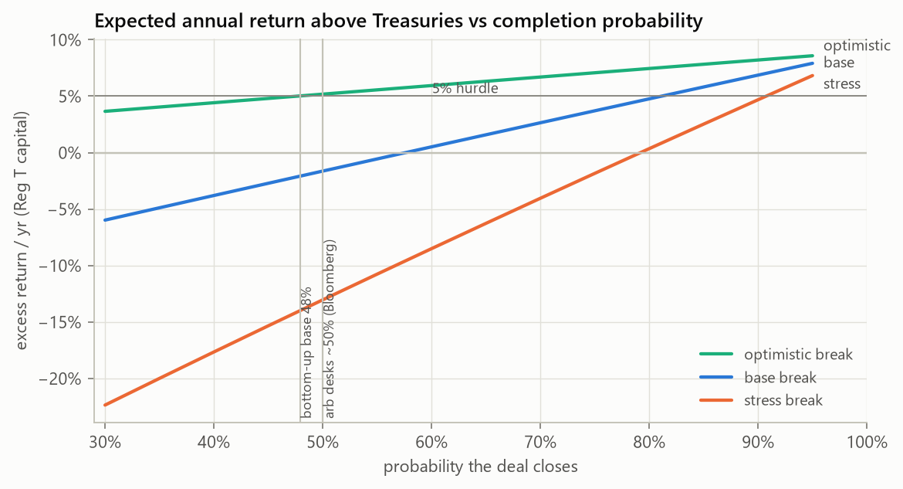
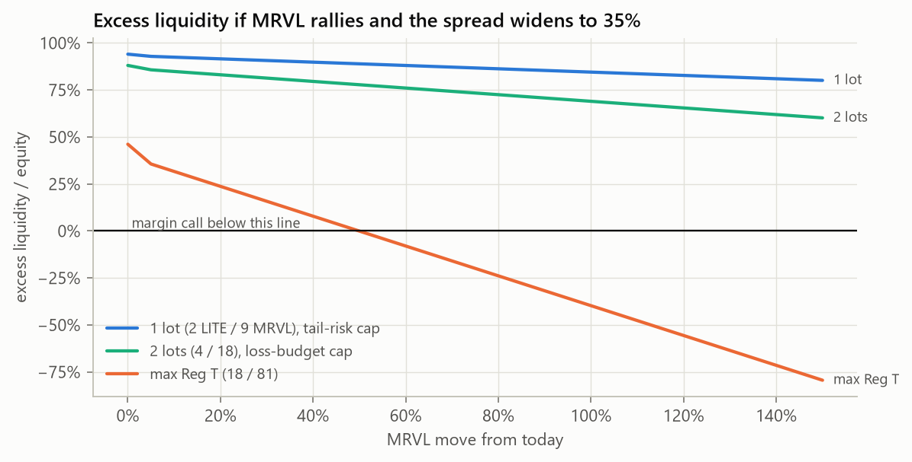

# Marvell / Lumentum merger arbitrage: research report

**As of the 2026-11-24 close.** LITE $487.12, MRVL $131.57 (closing prints; not live). Every number below comes from
`python scripts/build_report_assets.py` (deterministic seeds); the machine-written values are in
[`report_numbers.json`](report_numbers.json). Research only, not investment advice.

## Verdict: unattractive at today's spread, so NO TRADE

*Revised 2026-11-25.* The first version said WATCH at 63% completion odds. A gate-by-gate antitrust analysis
([ANTITRUST_AND_TRADING.md](ANTITRUST_AND_TRADING.md)) lowered completion to **48%**, which is the market's own ~50%.

The 21.5% gross spread is real. It is not a data error, a wrong ratio or a stale quote. It is wide because the market
gives the deal roughly even odds over a long, politically exposed timetable, with China's SAMR the main risk. If it
closes, a hedged position earns about **$101 per LITE share** (about 15% a year). If it breaks, the hedge turns into a
LITE/MRVL pair trade whose outcome depends almost entirely on where LITE would trade on its own. That is the one input
nobody can pin down: our estimates run from **$427 to $613**.

| | Value |
|---|---|
| Base case (48% completion, blended break price) | expected return of about **2.5% a year** on Reg T capital, **2.1% a year below Treasuries** (4.6%) |
| Stress case (LITE trades like the worst-hit optical peer, MRVL fully rebounds) | expected loss; break-even completion probability **69%** |
| Spread needed to clear a 5% excess-return hurdle at base assumptions | **35% gross** (today 21.5%) |
| Position cap for a $10k account if traded anyway | **1 lot = 2 LITE long / 9 MRVL short** (Monte Carlo tail-risk cap); 2 lots at most (loss budget) |
| What would change the call | a spread of ≥ 35% (the trigger ladder's first rung), or a well-founded view that standalone LITE is worth ≥ ~$600. At today's spread, even near-certain China approval only lifts completion to ~73%, below the ~81% that would clear 5% under the base break case. |

Classification (from the brief's four options): **Unattractive: the spread adequately compensates for the risks.** It is
not "Avoid": borrow is cheap and plentiful, and the trade can be executed and margined at small size. The automated
signal (`mergerarb.analytics.signal`) gives **NO TRADE**: the expected excess return is negative at 48%, and expected
P&L is negative under the stress break case.

---

## 1. The transaction (primary sources)

All terms come from the Agreement and Plan of Merger dated 2026-11-01 (Exhibit 2.1 to Marvell's 8-K, read in full),
Marvell's 8-K Item 1.01 and the joint press release. Links are in [Sources](#sources).

| Term | Detail |
|---|---|
| Consideration | **4.50 MRVL shares per LITE share** (s3.1(a)(i)); no cash; cash in lieu of fractions (s3.1(e)) |
| Collar / adjustment | **None.** Fixed ratio; s3.3 adjusts it only for splits, reverse splits and stock dividends. Both parties are barred from splits pending closing (s5.1). |
| LITE preferred (NVIDIA) | 2,876,415 Series A preferred convert as-converted x 4.5 into MRVL common, or elect MRVL Series B preferred (s3.1(a)(ii)) |
| Unaffected prices (Oct 28) | LITE $913.95, MRVL $251.65. 4.5 x 251.65 = $1,132.4, a 23.9% premium, which reproduces the press release. |
| Expected closing | "first half of calendar year 2028" (press release). Model base: 2028-03-31. |
| Outside date | 2027-11-01, extended automatically to 2028-02-01, then 2028-05-01, then **2028-08-01** while only regulatory conditions remain open (s8.1(b)(i)) |
| Votes | LITE: majority of **outstanding** voting power (s4.1(s)). MRVL: share issuance by a majority of votes present; charter amendment raising authorised shares (1.25bn) by a majority of **votes cast** (s4.2(r)). |
| Regulatory | HSR plus the approvals listed in s7.1(c) of the confidential Parent Disclosure Letter, so **the jurisdictions are not public** until the S-4. Efforts: reasonable best efforts. Marvell must accept remedies unless they are material to the combined company ("Burdensome Condition", s6.3(d)). |
| Termination fees | Marvell to LITE **$5.8bn** (MRVL board change of recommendation or Parent superior proposal); LITE to Marvell **$2.9bn**; regulatory reverse fee Marvell to LITE **$3.2bn** (~$33 per LITE share fully diluted) (s8.2). No fee is described for a plain failed vote. |
| Dividends | MRVL may keep paying its regular $0.06 quarterly dividend (s5.1(b)(i)); LITE may not pay any (s5.1(a)(i)) |
| Shares | LITE 93,459,271 common (8-K, 2026-11-23); MRVL 877,987,882 common (s4.2(b)) |

**What a LITE holder receives:** 4.5 MRVL shares per share. **The hedge:** short exactly 4.5 MRVL per LITE long. IBKR
does not allow fractional short sales, so the smallest exact lot is **2 LITE / 9 MRVL** ($974 long / $1,184 short at
today's closes). At completion the LITE shares convert into MRVL shares that offset the short in the same account, so no
closing trade is needed.

## 2. The spread, and why it is this wide

- **Today:** implied value 4.5 x $131.57 = **$592.07** vs LITE $487.12, so the spread is **$104.94 (21.5%)**. To a
  2028-03-31 close (1.35 years) that is **15.5% a year compounded**.
- **Since the terms were announced:** the spread opened at 12.7% (Nov 2) and drifted wider. Mean 17.7%, standard
  deviation 2.3 points, daily changes with a 1.6-point standard deviation. **Today's 21.5% is the widest close since
  announcement** (100th percentile, z = 1.65, n = 17).

### Is it a data error? No.
- **Ratio:** 4.50, from the merger agreement itself, cross-checked against the press release's $1,132 and 23.9%.
- **Prices:** Yahoo daily closes match an independent Cboe download exactly for Oct 20 to Nov 18 (22 sessions per stock,
  zero difference). Google Finance confirms the Nov 23 and Nov 24 closes for both.
- **Stale quotes:** Yahoo's after-hours bid/ask pairs are unusable (LITE bid 559.21 > ask 542.79; QQQ bid 717 vs last
  638). The tool flags and ignores them; only closing prints are used.
- **Splits / corporate actions:** none in the data, and the agreement prohibits them before closing.
- **Stale market data generally:** the whole AI-semiconductor complex really did crash this month. LITE is down 46.7%
  and MRVL 47.7% since Oct 28 (SMH -24.8%, AAOI -53%, COHR -18%). The press reports the same moves (e.g. NVIDIA +31% on
  Nov 23 after its CEO was reinstated; snippets only).

### Is it unusually wide? Yes: wider than every comparable deal that closed.

The comparison uses CRSP daily data for 21 large US deals. 16 trading days after announcement (where MRVL/LITE is
today), the nine validated completed deals ranged from 1.2% to 16.6% (**median 3.9%**). Six deals that later failed had
a **median of 12.1%**. Only Anthem/Cigna (23.9%, later blocked in court) was wider than MRVL/LITE is now. Wide spreads
have still closed: Microsoft/Activision was at 16.6% on day 16, and AMD/Xilinx reached 41.5% during China's review in
2021 before closing. Terms were validated by requiring the final-day spread of each completed deal to be within ±1.5%.
DuPont/Dow and Avago/Broadcom failed that test and are excluded. Raw CRSP data are licensed and are not in this repository.

### Why the market charges this much

1. **Time and China.** Closing is guided to 1H-2028, and the outside-date chain runs to 2028-08-01. Commentators name
   China's SAMR as the main antitrust and timing question (Breakingviews, Bloomberg Intelligence; search snippets).
   SAMR has let US chip deals lapse before: Intel ended its $5.4bn Tower acquisition in August 2023 after China failed
   to approve it in time (Bloomberg, Fortune, SCMP). DuPont paid a $162.5m fee when its Rogers deal failed SAMR review
   (search snippet). Qualcomm/NXP (2018) ended the same way (public record; not re-verified here). SAMR has also cleared
   Marvell's own Cavium and Inphi deals, which management cites as a reason its timetable is conservative (snippet).
2. **Both shareholder votes.** MRVL fell about 20% more than its sector beta implied around the announcement, and
   holders cite dilution. LITE's vote needs a majority of *outstanding* shares. The offer ($592) is now worth far less
   than LITE's pre-talks price ($914) and below our factor-model standalone value. LITE's CEO says shareholders are
   "not happy" (CNBC/Semafor, 2026-11-19; snippets).
3. **A crash regime that raises the cost of arbitrage capital.** Realised volatility since announcement is 164% (LITE)
   and 145% (MRVL) annualised. MRVL's option-implied volatility to March 2028 is 71% (front month 123%). FINRA short
   interest in MRVL rose only 6.6m shares between Oct 30 and Nov 13, about 1.5m LITE-equivalent arb positions (~1.6% of
   LITE). Arbitrage desks are not crowding in.
4. **Size.** LITE's equity is about $46bn at today's price. Large deals routinely outstrip dedicated arbitrage capital.
5. **Not borrow.** MRVL costs 0.32% a year to borrow with 10m shares available at IBKR (iBorrowDesk, 2026-11-24 16:44 ET).
   The three-month range is about 0.25-0.45% (read off the chart). Put-call parity across 17 expiries implies a borrow
   premium of about zero.

**What the market may know that we don't:** the confidential list of required approvals (Parent Disclosure Letter
s7.1(c)); arbitrage desks' counsel views and regulators' soundings; how large holders intend to vote and what proxy
advisers will say; customer reactions (NVIDIA owns LITE preferred); and the internal capital limits of the funds that
would normally close a spread like this. Bloomberg reported arbitrage specialists putting completion near **50%**
(2026-11-09; snippet only).

## 3. Quantitative model (`mergerarb/`)

### 3.1 Where would the stocks trade if the deal broke?
The textbook answer, "back to the unaffected price", is wrong after a 47% sector crash. Both unaffected prices are
snapshots of a market that no longer exists. Both stocks are therefore projected forward from Oct 28 with factor models
estimated on the 252 sessions before any deal news (`analytics/standalone.py`):

| LITE standalone estimate (as of Nov 24) | Price | ±1 residual sd |
|---|---|---|
| Two-factor (SMH + equal-weight optical peers), R² 0.70: the **optimistic** case | **$613** | $528-712 |
| Beta to SMH only | $599 | $483-744 |
| Peer ratio (COHR, AAOI, FN, CIEN) | $625 | $427-749 |
| Worst optical peer (AAOI-like, -53%): the **stress** case | **$427** | - |
| Geometric midpoint: the **base** case | **$512** | - |

MRVL's no-deal counterfactual (beta 1.44 to SMH) is **$167**, so **21.3% of its current price drop is deal-specific**.
If the deal breaks we assume half of that reverses (+13.5%) in the base case, and all of it (+27.0%) in the stress case.

### 3.2 Per-share payoffs of the exact hedge
**Completion: C = $104.94 spread - $1.35 dividends owed on the short (5 x $0.27) - $2.56 borrow = $101.04.**
This is locked regardless of where MRVL trades.

| Break case | LITE | MRVL jump | Break P&L per LITE share | Break-even completion probability |
|---|---|---|---|---|
| Optimistic: factor-model standalone, half reversal | $613 | +13.5% | **+$43.9** | 0% |
| Base: blended standalone, half reversal | $512 | +13.5% | **-$57.6** | **36%** |
| Stress: AAOI-like standalone, full reversal | $427 | +27.0% | **-$222.1** | **69%** |
| Literal brief: both back to Oct-28 prices | $914 | +91% | -$115.6 | 53% |
| Regulatory failure: stress + $3.2bn fee after tax (~$26/share) | $427 + 26 | +27.0% | -$195.9 | 66% |

The literal "LITE returns to its unaffected price" case is shown as asked, but it means LITE nearly doubles. The arb
still loses, because MRVL nearly doubles too.

**Market-implied view:** at the arb desks' ~50%, today's prices imply a break price for LITE of **$466** (if half of
MRVL's discount reverses) or **$546** (if all of it does). Both sit between our stress and optimistic estimates.

### 3.3 Completion probability: a labelled judgment, not a fact
| Condition | Low | Base | High | Rationale (abridged; full text in `analytics/probability.py`) |
|---|---|---|---|---|
| MRVL stockholders approve | 80% | 90% | 95% | low votes-cast bar; unanimous board; but a hostile reaction and dilution complaints |
| LITE stockholders approve | 80% | 90% | 96% | majority of outstanding; offer below pre-talks price; unhappy holders |
| Regulatory approvals before 2028-08-01 | 46% | 61% | 74% | gate by gate: US 0.93 × EU 0.94 × China 0.69 (SAMR base rate for comparable US chip deals); see [ANTITRUST_AND_TRADING.md](ANTITRUST_AND_TRADING.md) |
| No other termination | 93% | 97% | 99% | standard MAE carve-outs, reciprocal no-shops, large fees |
| **P(complete)** | **27%** | **48%** | **67%** | product; assumes independence (the first version had 80% for regulation and 63% overall) |

### 3.4 Expected return

At the base probability (48%) with the base break case, the expected P&L is **$18.4 per LITE share**. That is 3.4% on
Reg T capital ($540 per share) over 1.35 years, **2.5% a year, 2.1 points below Treasuries**. At the arb desks' 50% it
is -1.6 points a year, and it only reaches the 5% hurdle at about 81%. The stress case is negative until about 80%.
Only the optimistic break case (LITE worth ~$613 standalone) clears the hurdle at today's odds.

### 3.5 Scenarios (`analytics/scenarios.py`)
Each scenario runs day by day through an IBKR-style margin account. Borrow accrues daily, dividends are paid on
projected ex-dates, and a maintenance breach liquidates the position. The table shows **4 LITE / 18 MRVL on $10,000**
(the loss-budget size). P&L scales roughly linearly with size at these leverages.

| Scenario | Net P&L | % of equity | Notes |
|---|---|---|---|
| 1. Closes on schedule (2028-03-31) | +$398 | +4.0% | 2.9% a year on the whole account; 18% on Reg T capital |
| 2. Closes 3 months late | +$395 | +3.9% | |
| 3. Closes 6 months late (2028-09-29) | +$392 | +3.9% | **after the final outside date of 2028-08-01**; needs a negotiated extension |
| 4. Fails; both stocks back to Oct-28 prices | -$469 | -4.7% | the literal brief |
| 4b. Fails at the votes; optimistic break | +$169 | +1.7% | |
| 4c. Fails at the votes; stress break | -$895 | -9.0% | |
| 4d. Regulatory failure at the final outside date | -$776 | -7.8% | includes ~$26/share after-tax fee value |
| 5. MRVL -40%, deal closes | +$401 | +4.0% | the ratio hedge locks the spread |
| 6. MRVL +60% while LITE lags (spread 35%), closes | +$392 | +3.9% | no margin call at this size |
| 7. Both -40%, closes | +$401 | +4.0% | |
| 8. Borrow rises to 5% from Jan-2027 | +$259 | +2.6% | |
| 9. Hard-to-borrow: 30% fee, recall forces close-out at a 30% spread | -$328 | -3.3% | |

**Path risk at full Reg T leverage (18 LITE / 81 MRVL, about 1.9x gross):** scenario 6 hits a **margin call on
2027-02-11 for -22%**, even though the deal later closes. The stress break costs -40% and the recall scenario -15%.

### 3.6 Monte Carlo (`analytics/montecarlo.py`)
- **Price model:** 20,000 daily paths to 2028-08-01. MRVL is geometric Brownian motion at its option-implied vol (71%).
  LITE's standalone value carries LITE's two-year pre-deal vol (85%) with 0.55 correlation to MRVL.
- **Spread model:** completing deals converge on a Brownian bridge; breaking deals drift wider before the news. Spread
  vol (21.5% a year in log terms) is calibrated on the post-announcement history.
- **Outcome model:** outcomes and dates are drawn from the probability table (votes around 2027-06-30; regulatory
  failures up to the outside date). The base model also draws each path's break price between the stress and optimistic
  estimates, and the MRVL reversal fraction between 0 and 1.

| 4 LITE / 18 MRVL, $10k (48% completion) | Base | Optimistic | Stress |
|---|---|---|---|
| Mean P&L | **+$118 (+1.2%)** | +$311 | -$218 |
| P(loss) | 27.5% | 23.1% | 35.6% |
| 95% VaR / expected shortfall | $2,331 / **$3,992** | $2,040 / $3,639 | $3,094 / $4,969 |
| P(margin liquidation) | 0.6% | 0.5% | 0.5% |

**Main insight:** if the deal breaks, the hedge becomes a 1.2x long-LITE / short-MRVL pair whose two legs have about 75%
relative volatility. The 5% tail therefore costs about 40% of the account even at 0.43x gross. Changing LITE's
standalone vol from 66% to 98% moves the expected shortfall only from $3,815 to $3,939, so the tail comes from the
break-price level and MRVL's moves, not from the vol choice.

### 3.7 Hedge ratio: contract ratio vs dollar-neutral (same simulated paths, per LITE share)
| Hedge (short MRVL per LITE) | Mean | Std | 95% shortfall | Mean if completed | Mean if broken |
|---|---|---|---|---|---|
| Contract ratio 4.50 | $25.6 | $430 | $1,099 | $100.9 | -$42.9 |
| Dollar-neutral 3.70 | $33.6 | $400 | $896 | $101.1 | -$27.8 |
| Variance-minimising 3.18 | $38.8 | $394 | $771 | $101.2 | -$17.9 |
| Unhedged long LITE | $70.4 | $569 | $407* | $101.7 | +$42.0 |

\*The unhedged leg shows a smaller 95% shortfall but a 60% chance of loss, and it is pure LITE exposure.

The contract ratio is the only hedge that locks the completion payoff, so it stays the default for execution.
**Dollar-neutral is not risk-neutral:** it leaves 0.8 MRVL shares of net long exposure per LITE share if the deal
closes. But because MRVL is expected to rebound on a break, a smaller short (about 3.2-3.7) lowers variance in this
model, and more so as break risk rises. That result depends on the reversal assumption. The antitrust analysis shows
the same thing from another angle: bad regulatory news mostly lifts MRVL.

### 3.8 Position sizing and margin (`analytics/margin.py`)
IBKR's published US stock requirements (read 2026-11-24): long 26.25% initial / 25% maintenance; short 31.5% / 30%;
Reg T 50% end of day; $2,000 minimum equity. IBKR may impose higher house margin on stocks "involved in tenders and
other corporate action", so LITE could be margined above these rates. The real number comes from IBKR's what-if check,
which the execution module runs before any order.

| Lots (2 LITE / 9 MRVL each) | Gross leverage | Excess liquidity | Loss in worst plausible stress* | Extreme stresses survived |
|---|---|---|---|---|
| 1 | 0.22x | $9,401 | -4.4% | all |
| **2 (loss-budget cap)** | 0.43x | $8,802 | -8.8% | all |
| 3 | 0.65x | $8,204 | -13.2% | all |
| 5 | 1.08x | $7,006 | -22.0% | all |
| 6 | 1.30x | $6,407 | -26.4% | fails 2 of 3 |

\*Worst of: LITE to the stress break price with MRVL +27%; MRVL +40% with LITE +10%; both +60%. The survival test asks
that no margin call occur at LITE -40% / MRVL +50%, both +150%, or MRVL +100% / LITE +20%. The policy is: worst
plausible loss ≤ 10% of equity, excess liquidity ≥ 50%, Reg T met, survival with a 25% buffer. That gives 2 lots. Adding
a Monte Carlo cap (95% expected shortfall ≤ 20% of equity) gives **1 lot**.

## 4. Short selling and financing
- **Borrow:** easy to borrow at 0.32%. The fee that would wipe out the entire spread is about **13% a year**
  ($104.94 / (4.5 x $131.57 x 1.35 years)). Recall risk is low: MRVL has 878m shares outstanding and short interest is
  3.7% of them.
- **Short proceeds:** IBKR pays **0%** on the first $100k of short proceeds, and less again below $100k NAV. It pays no
  interest on the first $10k of cash. A $10k account therefore earns nothing on the short proceeds that institutional
  arbs earn interest on. A cash-funded long with proceeds held as collateral means **no margin loan** (IBKR's margin
  rate would be 5.38% = benchmark + 1.5%).
- **Dividends:** the short pays $0.27 per LITE-equivalent each quarter; 5 ex-dates are expected before 2028-03-31.
- **Commissions:** IBKR Pro Fixed charges $0.005/share, $1 minimum per order. For 4 LITE + 18 MRVL that is $2 to enter
  and nothing to exit (the shares convert). The model also charges an assumed 5 bps half-spread plus 5 bps slippage per
  leg.
- **Uptick rule:** Rule 201 restricts short sales for the rest of the day and the next session after a 10% intraday
  drop. MRVL fell 11.7% on Nov 20. The execution module warns when the rule may apply.

## 5. Recommendation details
| Item | Recommendation |
|---|---|
| Classification | **Unattractive** at a 21.5% spread (fairly priced); signal **NO TRADE** (revised from WATCH, 2026-11-25) |
| Entry spread | ≥ **~35% gross** at today's assumptions (trigger ladder rung; fires only on live executable quotes), or a well-founded view that LITE is worth ≥ ~$600 standalone |
| Maximum MRVL borrow fee | re-evaluate above **1%**; hard stop above **3%** |
| Maximum position ($10k) | **1 lot (2 LITE / 9 MRVL)**; 2 lots at most |
| Minimum excess liquidity | **≥ 50% of equity** (≥ $5,000) |
| Expected holding period | ~16 months to the base close (2028-03-31); up to 2028-08-01 |
| Expected / downside return (2 lots) | completion +4.0% of equity; Monte Carlo mean +1.2% (base) / -2.2% (stress); 5% worst ≤ -23% (base) / -31% (stress) |
| Invalidation | MRVL board changes its recommendation; ratio renegotiated; organised vote opposition or negative proxy advice at either company; SAMR refuses or stops the clock; HSR second request with structural remedies; borrow > 3%; outside date passes without extension |

**Events to monitor:** MRVL Q3 FY27 results (Dec 1, 2026); the S-4 filing (approvals list, merger background,
projections, fairness analyses); proxy-adviser reports and vote dates; HSR timing; SAMR filing acceptance and phase;
any 13D at either company; MRVL dividend declarations; daily borrow fee and availability; LITE's own quarterly results;
AI-capex news.

## 6. Provenance and limits
- **Read in full:** merger agreement; both merger 8-Ks; press release; LITE's 2026-11-23 8-K (share count); MRVL's
  2026-11-12 8-K (three new directors with "no arrangement or understanding", so not an activist settlement); IBKR's
  margin, interest, short-sale-cost and commission pages; iBorrowDesk's MRVL page; Disruption Banking (2026-11-06).
- **Search snippets only:** Bloomberg (50% odds), Breakingviews, Bloomberg Intelligence, CNBC/Semafor (Hurlston),
  Wedbush, GuruFocus, 24/7 Wall St, Benzinga, and the SAMR precedent coverage. Treat these as reported, not verified.
- **Market data:** Yahoo chart/quote/options endpoints (unofficial; research use; raw data not redistributed), FINRA
  short interest API, US Treasury par curve, local licensed CRSP (derived statistics only).
- **Judgment, not fact:** completion probabilities, break prices, reversal fractions, the hurdle, the stress set. Every
  one is a parameter in the code and the dashboard.
- **Not verified:** IBKR house margin for LITE as a merger target; actual fills, slippage and borrow at execution. The
  execution module has **not been run against a live TWS or IB Gateway** (none is installed on this machine). It is
  tested against a simulated broker.

## Sources
- Merger agreement (Ex. 2.1): https://www.sec.gov/Archives/edgar/data/1835632/000119312526442717/d352474dex21.htm
- Marvell 8-K, Item 1.01: https://www.sec.gov/Archives/edgar/data/1835632/000119312526442717/d352474d8k.htm
- Joint press release (Ex. 99.1): https://www.sec.gov/Archives/edgar/data/1835632/000119312526442714/d81187dex991.htm
- Lumentum 8-K, merger: https://www.sec.gov/Archives/edgar/data/1633978/000119312526442758/d163169d8k.htm
- Lumentum 8-K, annual meeting (shares outstanding): https://www.sec.gov/Archives/edgar/data/1633978/000162828026075535/lite-20261118.htm
- Marvell 8-K, new directors: https://www.sec.gov/Archives/edgar/data/1835632/000183563226000026/mrvl-20261111.htm
- IBKR stock margin (US): https://ndcdyn.interactivebrokers.com/en/trading/margin-stocks.php?hm=us&ex=us&rgt=1&rsk=0&pm=1
- IBKR margin rates: https://ndcdyn.interactivebrokers.com/en/trading/margin-rates.php
- IBKR interest on cash: https://ndcdyn.interactivebrokers.com/en/accounts/fees/pricing-interest-rates.php
- IBKR short sale cost: https://ndcdyn.interactivebrokers.com/en/pricing/short-sale-cost.php
- IBKR commissions: https://ndcdyn.interactivebrokers.com/en/pricing/commissions-stocks.php
- iBorrowDesk (IBKR availability file): https://www.iborrowdesk.com/report/MRVL
- Disruption Banking, 2026-11-06: https://www.disruptionbanking.com/2026/11/06/why-the-market-is-discounting-marvells-115bn-lumentum-bid/
- Bloomberg, 2026-11-09 (snippet): https://www.bloomberg.com/news/articles/2026-11-09/marvell-lumentum-deal-odds-near-coin-flip-as-ai-trade-shudders
- Breakingviews, 2026-11-02 (snippet): https://www.breakingviews.com/columns/breaking-view/china-adds-latency-marvells-optical-mega-deal-2026-11-02/
- CNBC, 2026-11-19 (snippet): https://www.cnbc.com/2026/11/19/lumentum-marvell-deal-ceo-shareholders-cramer.html
- Intel/Tower termination: https://www.bloomberg.com/news/articles/2023-08-16/intel-s-tower-semiconductor-deal-ends-on-failure-to-get-signoff ;
  https://fortune.com/2023/08/16/intel-tower-semiconductor-merger-acquisition-fails-receive-china-regulatory-approval/
- SAMR review slowdowns (snippets): https://thecapitolforum.com/samr-shuffles-top-merger-officials-amid-probes-of-sensitive-chip-deals-2/ ;
  https://takshashila.org.in/content/blogs/20251103-china-doubles-down-on-weaponising-antitrust-regulations.html
- FINRA consolidated short interest API; US Treasury daily par yield curve; Yahoo Finance; Google Finance (cross-checks).
